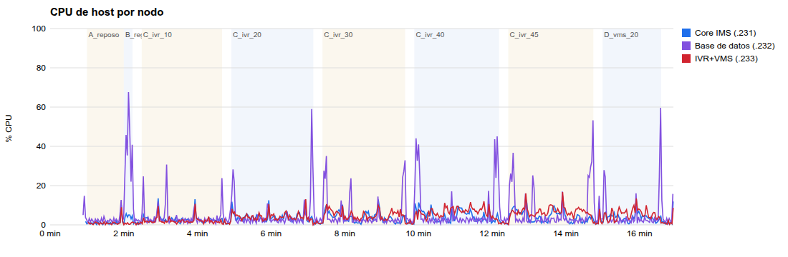
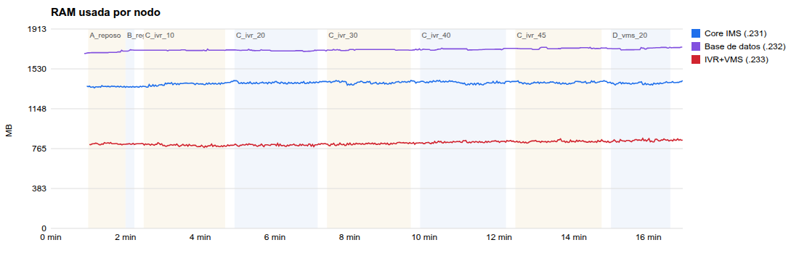
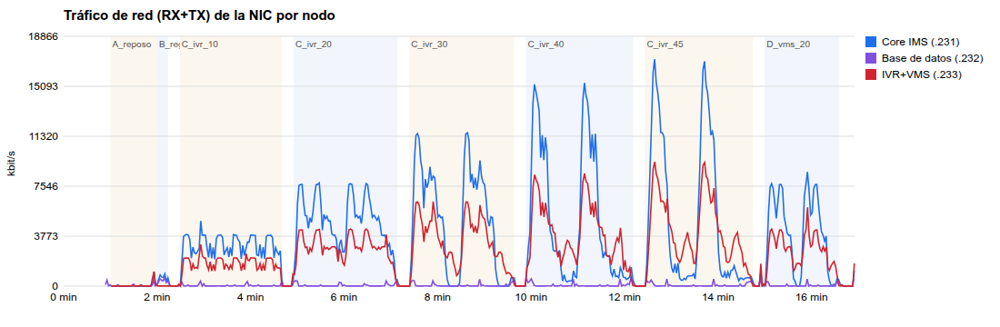
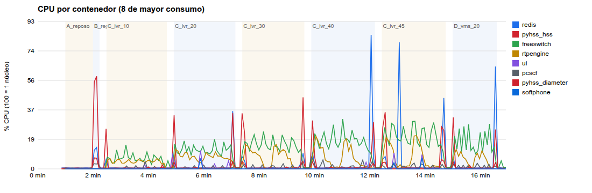
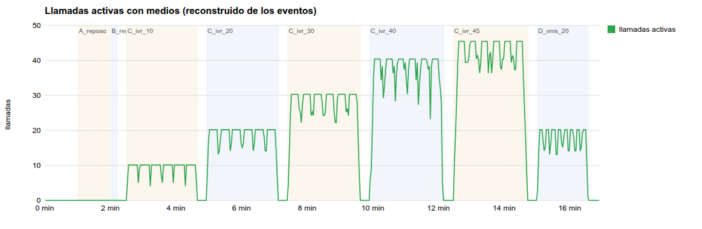
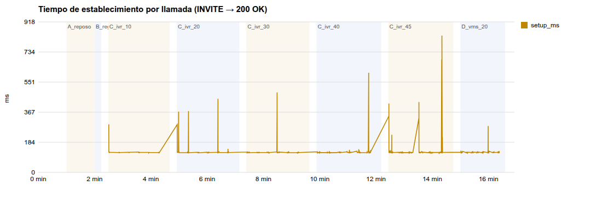

# Informe de pruebas de estrés — Maqueta IMS uVAS (DEV, Docker Swarm)

**Fecha de ejecución:** 2026-10-27 04:33–04:50 UTC (2026-10-26 23:33–23:50, hora local −05).  
**Entorno:** DEV, stack `mims3` en 3 nodos Swarm. [CONFIG]  
**Contrato de regresión:** `maqueta-ims-3/scripts/test_maqueta.sh` → 22/22 PASS antes y después de la batería. [CODE]  
**Datos crudos:** `datos/` (CSV de recursos por nodo y por contenedor, `results.jsonl` con cada registro y llamada, `stages.csv` con los límites de cada etapa).  
**Herramientas:** `maqueta-ims-3/scripts/stress/` (`loadgen.py`, `monitor.py`, `run_stress.sh`, `analyze.py`, `provision_load_ues.py`).

---

## 1. Resumen ejecutivo

- **Todas las llamadas de la batería se completaron:** 1 030 de 1 030 (IVR y buzón), con BYE 200 en todas y sin errores de transporte. El establecimiento (INVITE → 200 OK) se mantiene en **p50 ≈ 121 ms y p95 ≤ 149 ms** desde 10 hasta 45 llamadas concurrentes. [CODE]
- **La maqueta va holgada con 45 llamadas simultáneas:**
  - CPU media de host: Core 4,5 %, IVR 6,7 % y BD 7,2 %.
  - FreeSWITCH: 19,5 % de un núcleo y 76 MB.
  - RTPEngine: ≈ 5 % y 78 MB.

  La carga de medios no saturó ningún nodo. [CODE]
- **La debilidad es la ráfaga de registros:** con 50 registros a 5 por segundo, **6 de 50 (12 %) recibieron 504** a los ≈ 3 s, el p95 subió a 3,8 s y la CPU del nodo de BD llegó al 67,6 %, con `redis` al 84 % y `pyhss_hss` al 58 % de un núcleo. El HSS (PyHSS con SQLite y Redis) es el primer cuello de botella para tormentas de registro (por ejemplo, tras un corte de red). [CODE] [INFERENCE]
- **Hallazgo funcional bajo concurrencia:** el buzón `0100003` nombra los archivos `msg_%Y%m%d_%H%M%S.wav`, con resolución de un segundo. En la etapa D, **160 depósitos correctos produjeron solo 36 archivos, 12 de ellos vacíos (44 B)**: las grabaciones simultáneas del mismo segundo se sobrescriben. Hay **pérdida de mensajes**. Ver §6. [CODE]
- **Límites de la prueba, no de la maqueta:** (a) el pool RTP externo de 100 puertos (49900–49999) admite unas 50 sesiones de medios por el acceso VPN; (b) el generador entra por la VPN corporativa. No se llegó al punto de saturación de los componentes del núcleo; la capacidad máxima del §5 es una extrapolación. [CONFIG] [INFERENCE]

## 2. Entorno probado

| Nodo | Rol | vCPU | RAM | Contenedores |
|---|---|---|---|---|
| 192.168.5.231 (`hcmimsbed01`, manager) | Core IMS | 4 | 7,9 GB | dns, rtpengine, icscf, scscf, pcscf, asfront |
| 192.168.5.232 | Base de datos | 2 | 3,9 GB | redis, mysql, pyhss_api, pyhss_hss, pyhss_diameter |
| 192.168.5.233 | IVR + VMS | 4 | 7,9 GB | freeswitch, softphone, ui |

[CONFIG] (inventario `doc/hacom - maqueta IMS v1.1 - 10102026.csv` y `nproc`/`free` en cada nodo)

Configuración relevante durante la prueba [CONFIG]:
- P-CSCF publicado en `192.168.5.231:5060` UDP/TCP, en modo host.
- RTPEngine con dos interfaces:
  - `ext`: anunciada como `192.168.5.231`, puertos 49900–49999, `offer-timeout=60`.
  - `int`: overlay, puertos 49000–50000.
- RTPEngine en reenvío **userspace**: el módulo de kernel falla al crear las reglas nftables, según el log de arranque.
- Perfil no-3GPP Digest MD5 activo (`NON3GPP_DIGEST=1`).
- MTU de la overlay: 1450.

## 3. Metodología

### 3.1 Generador de carga (`loadgen.py`)

- Se ejecuta en el PC de pruebas y entra por la VPN (`ltc.hacom.com.pe`, NAT del cliente a `192.168.5.1`). Recorre el mismo camino que un softphone externo: P-CSCF externo → I-CSCF → S-CSCF → iFC → AS-Front → FreeSWITCH. Al ejecutarse fuera de DEV, **no consume CPU de los nodos medidos**.
- Cada UE virtual es un abonado de carga (`00101880NN`, provisionado temporalmente en PyHSS con `provision_load_ues.py` y **dado de baja al terminar**). En su propia conexión TCP hace:
  1. REGISTER Digest (401 → 200);
  2. un bucle de INVITE → 200 → ACK;
  3. RTP PCMU real (tono de 440 Hz, tramas de 20 ms, 50 pps);
  4. BYE, y baja (`Expires: 0`) al final.
- El S-CSCF limita a **5 contactos por IMPU** (`max_contacts=5`), de ahí los 50 abonados distintos. [CODE]

### 3.2 Monitorización (`monitor.py`, en los 3 nodos)

- **Cada 2 s, del host:** CPU (`/proc/stat`), load1, RAM usada (`MemTotal − MemAvailable`), tráfico de `ens18` (kbit/s y pps) y conexiones TCP establecidas.
- **Cada ~4 s, de cada contenedor `mims3_*`:** `docker stats` (CPU en % de un núcleo, RAM y E/S de red).
- El tráfico de `ens18` incluye la señalización y el RTP externos y el tráfico VXLAN entre nodos de la overlay.

### 3.3 Escenarios

| Etapa | Descripción | Duración |
|---|---|---|
| A_reposo | Línea base sin carga | 60 s |
| B_registros | Ráfaga de 50 REGISTER (rampa de 5 UE/s), sin llamadas | ≈ 14 s |
| C_ivr_10 / 20 / 30 / 40 / 45 | N UE concurrentes llamando al IVR `0100002`, llamadas de 20 s con RTP y 1 s entre llamadas | 120 s por escalón, con 15 s de pausa entre escalones |
| D_vms_20 | 20 UE concurrentes depositando mensajes de 10 s en el buzón `0100003` | 90 s |

## 4. Resultados

### 4.1 Señalización y medios por etapa

| Etapa | Registros OK / intentos | Registro p50 / p95 (ms) | Llamadas OK / intentos | Éxito | Establecimiento p50 / p95 / máx (ms) | RTP recibido/enviado (media; mín) | BYE 200 |
|---|---|---|---|---|---|---|---|
| B_registros | **44 / 50** (6 × 504) | **2 373 / 3 827** | — | — | — | — | — |
| C_ivr_10 | 10 / 10 | 716 / 971 | 60 / 60 | 100 % | 121 / 123 / 293 | 0,672; 0,671 | 60 / 60 |
| C_ivr_20 | 20 / 20 | 601 / 937 | 120 / 120 | 100 % | 122 / 149 / 449 | 0,669; 0,649 | 120 / 120 |
| C_ivr_30 | 30 / 30 | 574 / 872 | 180 / 180 | 100 % | 121 / 123 / 488 | 0,670; 0,649 | 180 / 180 |
| C_ivr_40 | 40 / 40 | 1 262 / 2 284 | 240 / 240 | 100 % | 121 / 129 / 607 | 0,663; 0,615 | 240 / 240 |
| C_ivr_45 | 45 / 45 | 642 / 1 042 | 270 / 270 | 100 % | 121 / 134 / 835 | 0,666; 0,644 | 270 / 270 |
| D_vms_20 | 20 / 20 | 536 / 808 | 160 / 160 | 100 % | 122 / 127 / 283 | 0,897; 0,866 | 160 / 160 |

[CODE] (`datos/results.jsonl`)

**Cómo leer la columna RTP:** el generador envió exactamente 1 000 paquetes por llamada de 20 s (500 en los depósitos de 10 s). El 67 % recibido en el IVR **no es pérdida**: FreeSWITCH envía RTP mientras reproduce la bienvenida (9,2 s) y el menú, y después espera DTMF sin enviar audio. El valor es igual en todos los escalones, lo que confirma que no se degrada con la carga. El primer paquete de audio llega a los ≈ 540 ms del 200 OK (el `sleep 1000` del dialplan del buzón explica los ≈ 1 040 ms de la etapa D). [CODE] [INFERENCE]

### 4.2 Recursos de host por nodo

| Etapa | Nodo | CPU media / máx (%) | RAM usada máx (MB de total) | Red RX media / máx (kbit/s) | Red TX media / máx (kbit/s) |
|---|---|---|---|---|---|
| A_reposo | Core IMS | 1,2 / 10,2 | 1 370 / 7 941 | 16 / 116 | 45 / 979 |
| A_reposo | Base de datos | 2,6 / 12,7 | 1 709 / 3 915 | 12 / 77 | 25 / 348 |
| A_reposo | IVR+VMS | 1,1 / 9,0 | 824 / 7 941 | 61 / 979 | 13 / 120 |
| B_registros | Core IMS | 4,5 / 5,7 | 1 362 | 410 / 569 | 248 / 358 |
| B_registros | **Base de datos** | **40,6 / 67,6** | 1 713 | 115 / 188 | 311 / 447 |
| B_registros | IVR+VMS | 0,7 / 1,5 | 816 | 5 / 9 | 4 / 8 |
| C_ivr_45 | Core IMS | 4,5 / 15,1 | 1 415 | 2 454 / 8 570 | 2 553 / 8 580 |
| C_ivr_45 | Base de datos | 7,2 / 53,3 | 1 737 | 22 / 148 | 55 / 485 |
| C_ivr_45 | IVR+VMS | 6,7 / 16,7 | 859 | 1 668 / 5 025 | 2 549 / 4 642 |
| D_vms_20 | Core IMS | 3,8 / 13,4 | 1 407 | 2 014 / 3 928 | 2 039 / 4 705 |
| D_vms_20 | IVR+VMS | 5,4 / 13,4 | 863 | 1 183 / 3 646 | 1 548 / 2 292 |

La tabla con todas las etapas está en `graficas/resumen.md`. Los picos de CPU del nodo de BD (30–60 %) aparecen **al inicio de cada escalón**, cuando los UE se registran, y no durante la carga de llamadas (ver la gráfica de CPU). La RAM de los tres nodos se mantiene estable: ningún nodo superó el 45 % de uso. [CODE]

### 4.3 Contenedores (picos en toda la batería)

| Nodo | Contenedor | CPU media en carga (% de 1 núcleo) | CPU máx | RAM reposo → máx (MB) |
|---|---|---|---|---|
| BD | mims3_redis | 2,9 | **84,2** | 499 → 537 |
| BD | mims3_pyhss_hss | 2,5 | **58,2** | 71 → 71 |
| IVR | mims3_freeswitch | 12,9 | 31,3 | 33 → 76 |
| Core | mims3_rtpengine | 5,7 | 20,9 | 37 → 78 |
| Core | mims3_pcscf | 0,9 | 7,4 | 127 → 128 |
| Core | mims3_scscf | 0,9 | 6,5 | 63 → 66 |
| BD | mims3_pyhss_diameter | 0,9 | 6,9 | 33 → 33 |
| Core | mims3_icscf | 0,2 | 4,7 | 25 → 27 |
| Core | mims3_asfront | 0,4 | 4,3 | 19 → 20 |
| BD | mims3_mysql | 0,6 | 1,0 | 391 → 391 |

**Coste incremental medido por escalón** (media dentro de la etapa, sin la rampa de registro) [CODE]:

| Concurrencia | FreeSWITCH CPU (%) | FreeSWITCH RAM máx (MB) | RTPEngine CPU (%) |
|---|---|---|---|
| 10 | 6,5 | 45 | 4,4 |
| 20 | 11,7 | 54 | 6,8 |
| 30 | 14,8 | 65 | 5,5 |
| 40 | 17,4 | 73 | 5,4 |
| 45 | 19,5 | 76 | 5,0 |

La CPU de FreeSWITCH crece ≈ 0,4 % de un núcleo por llamada y su RAM ≈ 0,9 MB por llamada. [INFERENCE]

### 4.4 Gráficas








Las versiones vectoriales (`.svg`) están junto a cada PNG.

## 5. Capacidad estimada (extrapolación)

Supuestos: G.711 sin transcodificar y crecimiento lineal medido hasta 45 llamadas. Objetivo de uso del 70 % por nodo. [ASSUMPTION]

| Recurso | Medido a 45 llamadas | Límite estimado | Primer límite real |
|---|---|---|---|
| FreeSWITCH (4 vCPU) | 19,5 % de 1 núcleo | ≈ 0,4 %/llamada → **≈ 600 llamadas** con 280 % de CPU | Por encima de unos cientos de llamadas suelen limitar antes la E/S de disco de las grabaciones y el `max-sessions` de FreeSWITCH (no medidos). [INFERENCE] |
| RTPEngine (userspace) | ≈ 5 % | Crece poco por encima de 20 llamadas; en userspace el coste por paquete es mayor que con el módulo de kernel | **Pool `ext` de 100 puertos ≈ 50 sesiones externas** (configuración actual). [CONFIG] |
| Red del Core (`ens18`, 1 Gbit/s supuesto) | 8,6 Mbit/s de pico en cada sentido | ≈ 175 kbit/s por llamada y sentido (PCMU por el lado ext + overlay VXLAN) → miles de llamadas | No es límite en DEV. [INFERENCE] |
| HSS (PyHSS + Redis, 2 vCPU) | 67,6 % de CPU del nodo con 5 reg/s | Por encima de ≈ 4–5 REGISTER/s aparecen 504 por *timeout* (TransactionTimeout = 5 s en I-/S-CSCF; los 504 llegaron a ≈ 3 s) | **Primer cuello de botella medido.** [CODE] [INFERENCE] |

## 6. Hallazgos y recomendaciones

| # | Severidad | Hallazgo | Evidencia | Recomendación |
|---|---|---|---|---|
| E-1 | **Alta** | Pérdida de mensajes con depósitos concurrentes: `msg_%Y%m%d_%H%M%S.wav` colisiona en el mismo segundo | Etapa D: 160 depósitos correctos y solo 36 archivos, 12 vacíos (44 B) | Incluir `${uuid}` en el nombre (`msg_%Y%m%d_%H%M%S_${uuid}.wav`) y ajustar la validación de `/api/vms/media`. En producción, usar la clave `uuid` del diseño de almacenamiento (`06_arquitectura/almacenamiento_y_recuperacion_buzones.md`). |
| E-2 | Media | Ráfaga de registros: 12 % de 504 a 5 reg/s; HSS de 2 vCPU con CPU alta en `redis` y `pyhss_hss` | Etapa B; CPU de BD al 67,6 % | Dimensionar el HSS para tormentas de registro (más vCPU, PyHSS con varios *workers* o un HSS comercial, BD no SQLite). Escalonar los registros en los clientes (registro con *jitter*). |
| E-3 | Media | RTPEngine reenvía en userspace: el módulo de kernel falla al crear las reglas nftables | Log de arranque de `mims3_rtpengine` | Habilitar `xt_RTPENGINE`/nftables en el host o usar el modo iptables legado (`--xtables`) para escalar medios. |
| E-4 | Media | El pool RTP `ext` limita el acceso por VPN a ≈ 50 sesiones; antes de la corrección de hoy (20 puertos y `offer-timeout` de 3600 s) se agotaba por sesiones huérfanas y el audio de subida se perdía | Log del P-CSCF: «Ran out of ports»; corregido a 100 puertos y `offer-timeout=60` | Para más acceso externo, ampliar el rango (cada puerto publicado en modo host añade una regla DNAT) o usar un SBC. |
| E-5 | Baja | La batería no alcanzó la saturación del núcleo | — | Repetir con el generador dentro de DEV (otro nodo o VM) y SIPp, subiendo a 200–500 llamadas, para medir el límite real de FreeSWITCH y RTPEngine. |

## 7. Limitaciones

- El generador usa el perfil **no-3GPP (Digest MD5 por TCP)**: no ejercita IMS-AKA, IPsec ni `sec-agree`. Ese camino lo cubre `test_maqueta.sh` funcionalmente, pero no bajo carga. [CODE]
- El camino de medios pasa por la VPN corporativa. Los tiempos absolutos (≈ 105 ms de RTT) incluyen la VPN, y el p50 de establecimiento (≈ 121 ms) es prácticamente un RTT más el procesamiento. [INFERENCE]
- `docker stats` muestrea cada ≈ 4 s, así que los picos de menos de 4 s pueden quedar suavizados.
- Los registros de la etapa B usan abonados nuevos (UAR, MAR y SAR completos). Los re-registros periódicos son más baratos.

## 8. Reproducción

```bash
# 1) Abonados de carga (devuelve "msisdn,ki"; guárdalo fuera del repo)
ssh administrator@192.168.5.232 'docker exec -i $(docker ps -qf name=mims3_pyhss_hss) python3 - add 50' \
  < maqueta-ims-3/scripts/stress/provision_load_ues.py > /tmp/ues.csv
# 2) Batería completa (necesita VPN y SSH a los 3 nodos)
bash maqueta-ims-3/scripts/stress/run_stress.sh /tmp/ues.csv /tmp/stress_run
# 3) Tablas y gráficas
python3 maqueta-ims-3/scripts/stress/analyze.py /tmp/stress_run /tmp/stress_run/graficas
# 4) Limpieza
ssh administrator@192.168.5.232 'docker exec -i $(docker ps -qf name=mims3_pyhss_hss) python3 - del 50' \
  < maqueta-ims-3/scripts/stress/provision_load_ues.py
```

Limpieza hecha tras esta ejecución:
- abonados de carga dados de baja (`ims_subscriber` volvió a 3 filas);
- grabaciones de la etapa D borradas del buzón `0100003` (36 archivos, 3,4 MB);
- `test_maqueta.sh` final en 22/22.
