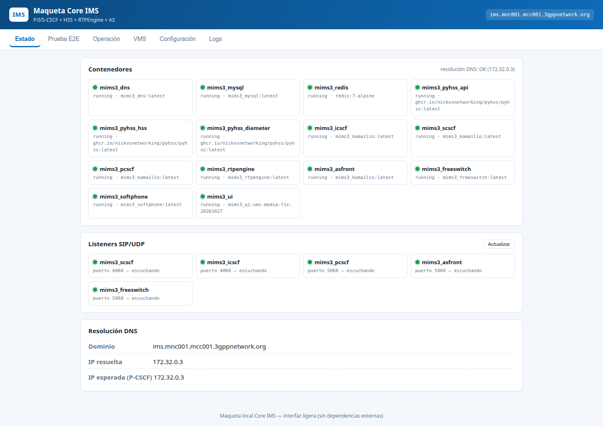
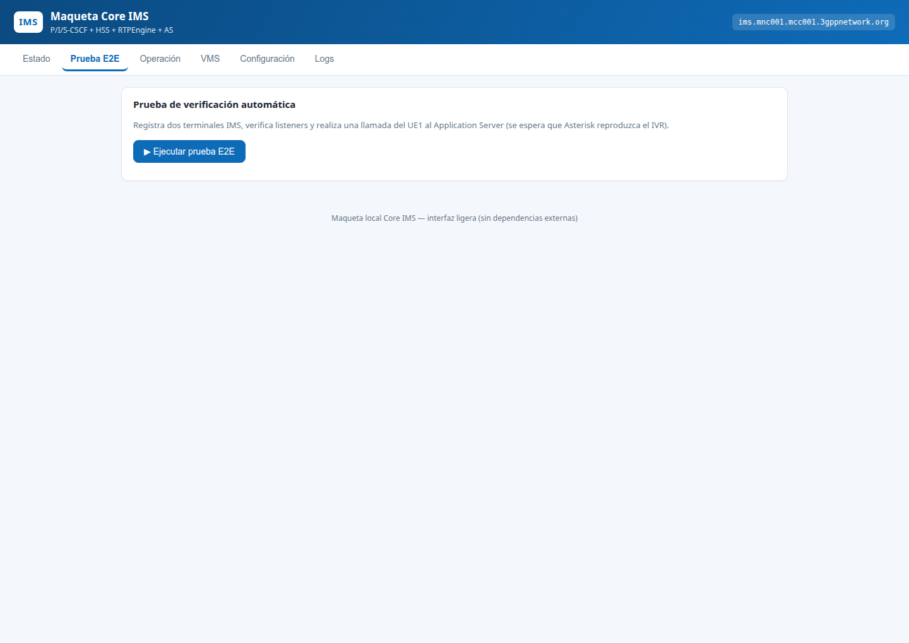
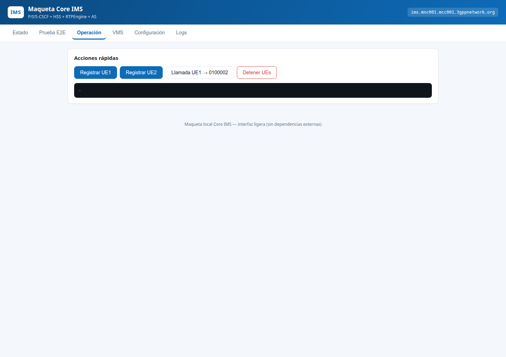
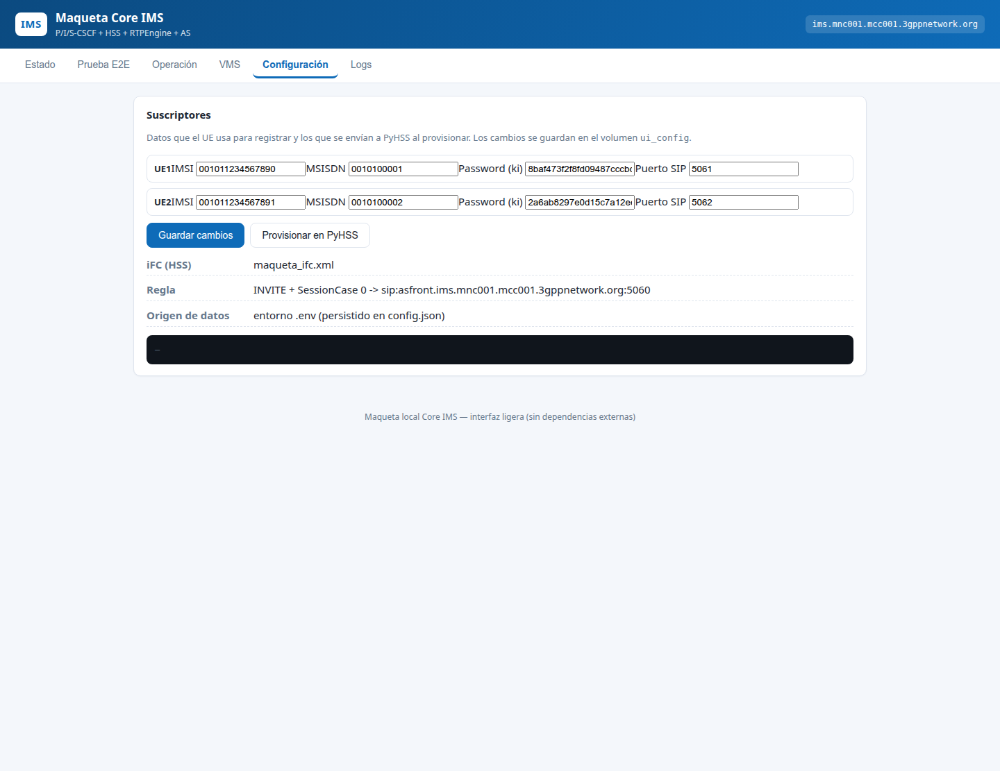
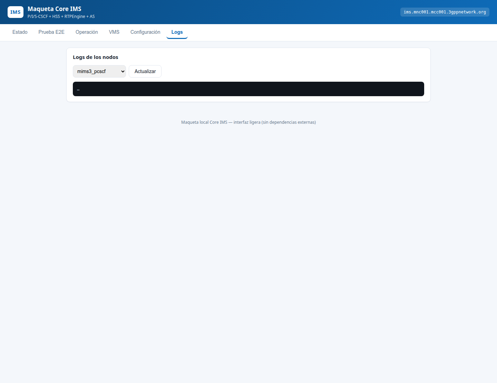
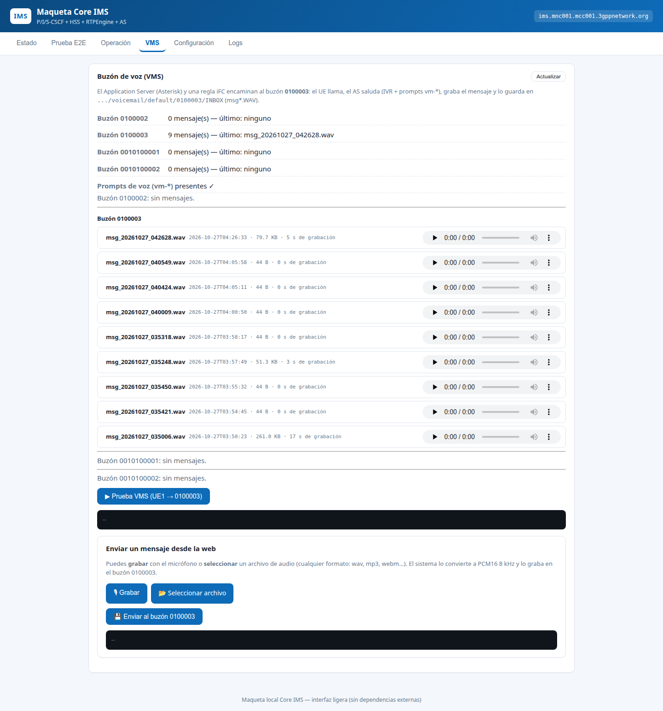
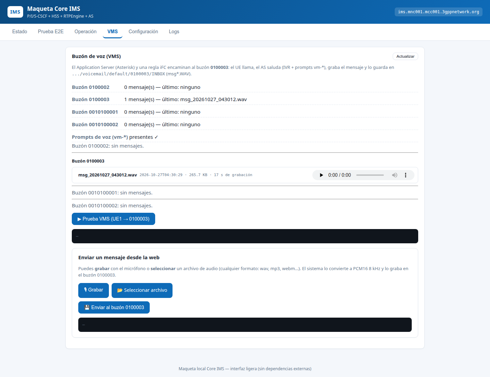

# Informe de QA — Acceso externo, IVR/VMS y estabilidad de la maqueta IMS (DEV)

**Fecha:** 2026-10-26/27 (hora local −05).  
**Entorno:** DEV, Docker Swarm `mims3` (Core IMS 192.168.5.231, BD 192.168.5.232, IVR+VMS 192.168.5.233). [CONFIG]  
**Rama / commits:** `feature/dev`. Base `881dbd0` (acceso externo + bienvenida nueva) más las correcciones de esta ronda; QA-10, QA-11 y QA-12 corregidos el 2026-10-27 (ver §8). [CODE]  
**Dispositivos:**
- Redmi Note 13 (Android 15, HyperOS 2.0) con Linphone 6.2.9 y OpenVPN for Android;
- PC Linux con cliente SIP de prueba (`scripts/stress/loadgen.py`) y Chrome sin interfaz gráfica para las capturas. [CONFIG]

---

## 1. Resumen

| Indicador | Resultado |
|---|---|
| Regresión funcional `test_maqueta.sh` | 6 ejecuciones. **22/22 PASS** en la línea base, en las 3 posteriores a cada corrección y en la final. Una ejecución intermedia dio **7/22** por QA-02, corregido a continuación. [CODE] |
| Casos de QA ejecutados en esta ronda | 24, todos aprobados después de las correcciones |
| Defectos encontrados | 20 registros (19 defectos y 1 error de uso). **10 corregidos** y verificados en DEV, **2 con solución temporal** y **7 abiertos**, ninguno de severidad alta. |
| Pruebas de estrés | 1 030/1 030 llamadas correctas hasta 45 concurrentes; 6/50 registros con 504 en la ráfaga. Ver `../07_pruebas_estres/INFORME_PRUEBAS_ESTRES.md`. |
| Dictamen | **Apto para demostración** del acceso externo por VPN (registro, IVR con la bienvenida nueva y depósito en buzón con audio). QA-10, QA-11 y QA-12 ya están corregidos (§8). Para producción siguen pendientes la autenticación de la API de la UI, los secretos fuera del repo (QA-18) y el almacenamiento de objetos del diseño de `06_arquitectura`. |

## 2. Alcance

**Dentro del alcance:**
- acceso externo por VPN (P-CSCF y RTPEngine publicados);
- perfil no-3GPP con Digest MD5;
- llamadas al IVR `0100002` (bienvenida nueva y menú DTMF) y al buzón `0100003`;
- interfaz web (pestañas Estado y VMS, listado y reproductor);
- regresión IMS-AKA/IPsec y FEAT-02 (`test_maqueta.sh`);
- estabilidad bajo carga.

**Fuera del alcance:** llamadas entrantes al softphone externo (MT), SRTP/TLS, calidad perceptual del audio (MOS), conmutación por fallo de nodos, y cambio de formato de audio (solo matriz teórica en `06_arquitectura/matriz_formatos_audio.md`).

## 3. Casos de prueba ejecutados

| ID | Caso | Método | Resultado | Evidencia |
|---|---|---|---|---|
| TC-01 | Regresión E2E (DNS, listeners, IMS-AKA + IPsec, IVR, DTMF, CDR, VMS, FEAT-02, MWI, PIN) | `test_maqueta.sh` (Swarm) | PASS 22/22 | logs de las ejecuciones; captura 02 |
| TC-02 | El P-CSCF responde desde la VPN | SIP OPTIONS por UDP a 192.168.5.231:5060 | PASS (200 OK) | §5.1 |
| TC-03 | Registro Digest desde el PC (UDP y TCP) | Cliente SIP de prueba | PASS (401 MD5 → 200 OK + Service-Route) | — |
| TC-04 | Los UE IMS-AKA no se ven afectados por el perfil Digest | `test_maqueta.sh` con `NON3GPP_DIGEST=1` | PASS (tras corregir QA-02) | — |
| TC-05 | Registro de Linphone desde el móvil | Manual + `uiautomator` | PASS («UE3 Linphone – Conectado») | §5.2 |
| TC-06 | Llamada móvil → IVR `0100002` con la bienvenida nueva | Manual | PASS (se oye el audio nuevo) | confirmación del usuario |
| TC-07 | Llamada móvil → buzón `0100003` | Manual | PASS en señalización; audio de subida PASS tras corregir QA-07 | captura 07 frente a TC-17 |
| TC-08 | Mensajes grandes por TCP (más de 1 500 B) | OPTIONS con relleno de 2,5 KB | PASS por TCP; **FAIL por UDP** (QA-04) | — |
| TC-09 | Bienvenida nueva desplegada (WAV 8 kHz mono, 9,2 s) | `test_maqueta.sh` + llamada | PASS | captura 02 |
| TC-10 | Menú DTMF tras la bienvenida de 9 s | `test_maqueta.sh` paso 5b | PASS | — |
| TC-11 | Listado de mensajes en la pestaña VMS | API `/api/vms` + captura | PASS tras corregir QA-08 | capturas 07 → 08 |
| TC-12 | Reproducción web de un mensaje | `GET /api/vms/media` | PASS tras corregir QA-09 (200, audio/wav, 17 s) | captura 08 |
| TC-13 | Estado de los contenedores y listeners | Pestaña Estado | PASS (17 contenedores en ejecución, 5 listeners) | captura 01 |
| TC-14 | Ráfaga de 50 registros | `loadgen.py --register-only` | **FAIL parcial**: 44/50 (QA-16) | informe de estrés §4.1 |
| TC-15 | 10–45 llamadas IVR concurrentes | `run_stress.sh` | PASS 870/870 | informe de estrés |
| TC-16 | 20 depósitos de buzón concurrentes | `run_stress.sh` | PASS en señalización (160/160); **FAIL en persistencia** (QA-10). Repetido tras la corrección: **PASS** (20 llamadas → 20 archivos) | informe de estrés §6; §8 |
| TC-17 | Audio de subida externo hasta la grabación | Llamada con RTP de 5 s por la VPN | PASS (RTP 300/249, grabación de 81 644 B) | — |
| TC-18 | Pantallas Prueba E2E, Operación, Configuración y Logs | Capturas | PASS (renderizan sin errores) | capturas 02, 03, 05, 06 |
| TC-19 | Mensaje de error ante un número inexistente | Llamada a `010002` | PASS (604 coherente) | §5.2 |
| TC-20 | Sesiones RTPEngine huérfanas liberadas | `rtpengine-ctl list` tras ofertas sin respuesta | PASS con `offer-timeout=60` | — |
| TC-21 | Limpieza tras el estrés | Baja de abonados de carga y borrado de grabaciones | PASS (`ims_subscriber` = 3) | — |
| TC-22 | Credenciales fuera de los entregables | Revisión de los .md y .drawio | PASS (sin USER/PASS del inventario) | — |
| TC-23 | Diagramas .drawio bien formados | `xml.dom.minidom` + ids y parents | PASS | `06_arquitectura/` |
| TC-24 | Pantalla VMS sin errores de consola tras los arreglos | Captura después del despliegue | PASS | captura 08 |

## 4. Defectos

Severidad: **Alta** = pérdida de datos o seguridad; **Media** = funcionalidad degradada o con solución temporal; **Baja** = cosmética o documental.

| ID | Sev. | Componente | Descripción | Causa raíz | Estado |
|---|---|---|---|---|---|
| QA-01 | Media | Arquitectura | El P-CSCF no era alcanzable desde la VPN (solo escuchaba en la overlay) | Diseño Swarm sin puertos publicados [CODE] | **Corregido** (`881dbd0`): 5060 en modo host + `advertise` |
| QA-02 | Alta | S-CSCF / P-CSCF | Activar Digest rompía IMS-AKA (UE1 recibía un reto MD5; 7/22) | El P-CSCF retira `Security-Client` antes del core y el S-CSCF decidía por esa cabecera [CODE] | **Corregido**: cabecera `P-Maqueta-Non3GPP` |
| QA-03 | Media | P-CSCF | REGISTER externo → 504 | Kamailio reenviaba por el socket de gwbridge, que no alcanza la overlay [CODE] | **Corregido**: `mhomed=1` |
| QA-04 | Media | Red VPN / DNAT | INVITE por UDP de más de 1 500 B → 408 | Fragmentos IP descartados en el camino VPN/DNAT [CODE] | **Solución temporal**: el cliente usa TCP. Sigue abierto para UDP |
| QA-05 | Media | P-CSCF | INVITE → 403 «register first» si el cliente reescribe su Contact con la IP del NAT | `pcscf_is_registered` no encuentra el contacto con alias NAT [CODE] | **Solución temporal**: Linphone `enable_nat_helper=0`. Sigue abierto en el servidor |
| QA-06 | — | Uso | 604 al llamar a `010002` | Número mal marcado (rellamada desde el historial) | No es defecto |
| QA-07 | Alta | RTPEngine | Mensajes del móvil grabados vacíos (44 B); audio de subida perdido | Pool `ext` de 20 puertos agotado por ofertas huérfanas (`offer-timeout` de 3600 s), con lo que el P-CSCF reenviaba el SDP sin anclar [CODE] | **Corregido**: 100 puertos + `offer-timeout=60` |
| QA-08 | Media | UI | Lista de mensajes vacía aunque el contador marcaba 8 | `ls --time-style` no existe en busybox (imagen Alpine de FreeSWITCH) [CODE] | **Corregido**: `stat -c` |
| QA-09 | Media | UI | Reproductor web → 400 en todos los mensajes | La validación espera `msg\d+.wav`; los archivos son `msg_AAAAMMDD_HHMMSS.wav` [CODE] | **Corregido** |
| QA-10 | **Alta** | Dialplan VMS 0100003 | Depósitos concurrentes en el mismo segundo se sobrescriben: 160 depósitos → 36 archivos, 12 vacíos | Nombre con resolución de 1 s [CODE] | **Corregido** (§8): nombre `msg_AAAAMMDD_HHMMSS_<uuid>.wav` |
| QA-11 | **Alta** | FEAT-02 almacenamiento | Los mensajes de `mod_voicemail` (`/var/lib/freeswitch/storage/voicemail`) y su índice (`/var/lib/freeswitch/db`) no tienen volumen: se pierden al recrear la tarea | El compose de Swarm solo monta `storage/vms` [CODE] | **Corregido** (§8): volúmenes `mims3_fs_voicemail` y `mims3_fs_db`. En producción, almacenamiento de objetos (06_arquitectura) |
| QA-12 | **Alta** | Seguridad FEAT-02 | `/api/pin` lista todos los PIN sin autenticación; el PIN se guarda en claro y `vm_pin.lua` lo escribe en el log | Diseño de laboratorio [CODE] (verificado: `/api/pin` responde con la clave `pins` sin autenticar) | **Corregido** (§8): hash PBKDF2, API sin PIN, validación por POST con bloqueo y log sin PIN. Pendiente: autenticar la API de la UI |
| QA-13 | Media | Pruebas | `test_maqueta.sh` borra **todos** los mensajes del buzón 0100003 (`rm -f …/msg*`) | Línea 171 del test [CODE] | **Abierto**: usar un buzón de prueba propio o borrar solo los mensajes que crea |
| QA-14 | Baja | UI | El texto de la pestaña VMS dice «Asterisk» y `.../voicemail/default/0100003` | Texto heredado de la maqueta anterior [CODE] | **Abierto** |
| QA-15 | Baja | Documentación | `HLD_Maqueta_IMS_uVAS.md` dice que el P-CSCF no está publicado y que Digest está desactivado | Documento anterior al cambio [DOC] | **Abierto**: actualizar con los diagramas nuevos |
| QA-16 | Media | HSS | 12 % de 504 en una ráfaga de 5 registros/s | PyHSS + Redis en el nodo de 2 vCPU saturado [INFERENCE] | **Abierto**: ver el informe de estrés E-2 |
| QA-17 | Media | RTPEngine | Reenvío en userspace: falla la creación de las reglas nftables del módulo de kernel | Host sin soporte nftables para `xt_RTPENGINE` [CODE] | **Abierto** |
| QA-18 | Media | Seguridad | La Ki de UE3 (que también es su contraseña Digest) está en `.env` dentro del repo | Patrón ya existente para UE1/UE2 [CODE] | **Abierto**: secretos fuera del repo (Docker secrets o un gestor de secretos) |
| QA-19 | Baja | Infraestructura | El PC y el móvil comparten el perfil VPN; solo uno puede estar conectado a la vez | Un solo certificado/usuario [CONFIG] | **Abierto**: segundo perfil VPN para pruebas |
| QA-20 | **Alta** | Configuración | En `.env` la línea `UE2_KI` quedó pegada al comentario de UE3: un despliegue completo daría a UE2 una Ki incorrecta | Falta de salto de línea al añadir UE3 en `881dbd0` [CODE] | **Corregido** (§8); sin efecto en DEV, que se actualizó sin releer `.env` |

## 5. Evidencias

### 5.1 Comprobaciones de red y protocolo (extractos)

```text
OPTIONS UDP 100 B relleno  → SIP/2.0 200 OK
OPTIONS UDP 1500 B relleno → (sin respuesta)        # QA-04
OPTIONS TCP 2500 B relleno → SIP/2.0 200 OK
REGISTER Digest TCP        → 401 (MD5, qop=auth) → 200 OK
INVITE 0100003 + RTP 5 s   → SDP remoto 192.168.5.231:49972 (RTPEngine ext), RTP enviado 300 / recibido 249,
                             grabación msg_…_042628.wav = 81 644 B                       # QA-07 corregido
P-CSCF (antes):  rtpengine: proxy udp:mims3_rtpengine:2223: Ran out of ports
RTPEngine (antes): 10 sesiones propias, 0 pps (ofertas huérfanas)
```

### 5.2 Móvil (Linphone)

Linphone bloquea las capturas de pantalla (`FLAG_SECURE`), así que el estado se leyó con `uiautomator`:
- **menú lateral:** «UE3 Linphone — Conectado»;
- **historial de llamadas:** `0100002` (10:57 p. m., correcta), `010002` (10:55 y 10:56 p. m., la causa del 604) y `0100003` (10:54 p. m.).

### 5.3 Capturas de la interfaz web

**01 — Estado:** 17 contenedores en ejecución, imagen de UI `vms-media-fix-20261027`, listeners SIP y DNS correctos.  


**02 — Prueba E2E**  


**03 — Operación**  


**05 — Configuración de suscriptores**  


**06 — Logs**  


**07 — VMS antes de los arreglos:** el contador marcaba 9 y la lista ya salía (primera corrección desplegada). Se ven las grabaciones vacías (44 B, 0 s) de las llamadas del móvil, consecuencia de QA-07; el reproductor devolvía 400 (QA-09).  


**08 — VMS después de los arreglos:** lista correcta y reproductor operativo (`/api/vms/media` → 200, audio/wav, 17 s).  


> Nota: los 9 mensajes de la captura 07 los borró después `test_maqueta.sh` (QA-13). La captura conserva la evidencia.

## 6. Cambios desplegados en DEV durante la ronda

| Componente | Cambio | Copia de seguridad en el nodo |
|---|---|---|
| P-CSCF, S-CSCF, RTPEngine | Acceso externo, perfil Digest, `mhomed`, interfaz `ext` (commit `881dbd0`) | `.231:~/backup-ext-access-20261027-023801/` |
| FreeSWITCH | `ivr_bienvenida.wav` nuevo (audio del cliente, 8 kHz mono) | `.233:~/ivr_bienvenida.wav.antes-20261027-034648` |
| RTPEngine | Pool `ext` 49900–49999 (100 puertos publicados) + `offer-timeout=60` | ídem `.231` |
| UI | Imagen `mims3_ui:vms-media-fix-20261027` (listado con `stat`, validación del nombre de mensaje) | imagen anterior `mims3_ui:feature2-ui-fix-v5-20261014` y `.233:~/app.py.antes-*` |
| PyHSS | Abonado UE3 `0010100009` (Ki propia). Los abonados de carga de la prueba de estrés se dieron de baja | — |

**Reversión:** `docker service update --image mims3_ui:feature2-ui-fix-v5-20261014 mims3_ui` para la UI. Para P-CSCF, S-CSCF y RTPEngine, restaurar `antes.tar` y ejecutar `docker service update --force` sobre el servicio, quitando los `--publish` y `--env` añadidos.

## 7. Recomendaciones (por prioridad)

1. **Producción del almacenamiento (sigue a QA-11):** el volumen local de DEV ata los buzones al nodo IVR. El objetivo es almacenamiento de objetos con metadatos en BD (`06_arquitectura/almacenamiento_y_recuperacion_buzones.md`).
2. **API de la UI y QA-18:** autenticar la API (hoy `/api/pin` ya no expone PIN, pero la UI sigue abierta en la red de gestión), llevar el contador de bloqueo de PIN a Redis y sacar las Ki del repo.
3. **QA-13:** que la regresión no borre el buzón 0100003 completo.
4. **QA-05:** soportar en el P-CSCF clientes que reescriben su Contact con la IP del NAT (configuración por defecto de la mayoría de softphones).
5. **QA-16 y QA-17:** capacidad del HSS ante ráfagas y reenvío de RTPEngine en el kernel. Repetir el estrés con el generador dentro de DEV para hallar la saturación real.
6. **QA-14 y QA-15:** higiene de la UI y de la documentación.

## 8. Corrección de QA-10, QA-11 y QA-12 (2026-10-27)

| ID | Cambio | Verificación en DEV | Resultado |
|---|---|---|---|
| QA-10 | Dialplan `0100003`: `strftime` solo para la fecha (`vms_ts`) y `set` compone `msg_${vms_ts}_${uuid}.wav`. La UI acepta el nombre nuevo, el anterior y el heredado de Asterisk. [CODE] | 20 UEs de carga, 20 depósitos simultáneos en `0100003` | **PASS**: 20/20 llamadas 200, 20 archivos nuevos, ninguno vacío; hasta 6 grabaciones en el mismo segundo sin colisión. El reproductor web devuelve 200 con el nombre nuevo y rechaza nombres no válidos. |
| QA-11 | Volúmenes `mims3_fs_voicemail` (`/var/lib/freeswitch/storage/voicemail`) y `mims3_fs_db` (`/var/lib/freeswitch/db`) en `docker-compose.yml`, aplicados con `docker service update --mount-add`. [CONFIG] | Depósito en el buzón de UE2, `docker service update --force mims3_freeswitch` y nuevo `vm_boxcount` | **PASS**: `1:0:0:0` antes y después del reinicio (1 archivo .wav en el volumen). |
| QA-12 | Columna `pin_hash` (PBKDF2-SHA256, 100 000 iteraciones, sal aleatoria) y migración automática al arrancar la UI; `/api/pin` ya no devuelve PIN; `/api/pin/auth` solo por POST, con bloqueo de 15 min tras 5 fallos; `vm_pin.lua` registra solo el número de dígitos. [CODE] | Consultas a la BD y a la API, llamada de recuperación por `0100004` | **PASS**: tabla con `LENGTH(pin)=0` y hash de 118 caracteres; GET a `/api/pin/auth` → 405; PIN correcto → `ok:true`, incorrecto → `ok:false`; 6.º fallo → 429; 0 líneas con `pin=` en el log de FreeSWITCH. |
| QA-20 | `.env`: salto de línea entre `UE2_KI` y el bloque de UE3. [CONFIG] | `docker compose config` | **PASS**: `UE2_KI` vuelve a tener su valor. |

**Regresión:** `SWARM_MODE=1 bash scripts/test_maqueta.sh` → **22/22 PASS** (`test_maqueta_qa10-11-12.log`), incluida la recuperación con PIN de UE2 en `0100004` sobre el hash nuevo. [CODE]

**Fallos encontrados durante la corrección (corregidos antes del commit):**
- El hash usaba `$` como separador y el valor viaja dentro de un comando de shell con comillas dobles hacia mysql: `$100000` se expandía y el PIN correcto no validaba. Ahora el separador es `:`; los dos PIN de prueba sembrados se restauraron y se volvieron a migrar. [CODE]
- La aplicación `strftime` de FreeSWITCH trunca su salida a unos 80 caracteres: la ruta perdía el final del uuid y la extensión (`….PCMU`). Por eso la fecha y el nombre se componen por separado. [CODE]

**Limitaciones que siguen abiertas:**
- el contador de fallos de PIN vive en la memoria de la UI y se reinicia con ella (en producción, Redis);
- la API de la UI sigue sin autenticación, aunque ya no expone PIN;
- el volumen local ata los buzones al nodo IVR (`.233`).

**Despliegue y reversión:**
- imagen de UI `mims3_ui:pin-hash-20261027b` (anterior: `mims3_ui:vms-media-fix-20261027`);
- copia de los archivos sustituidos en cada nodo: `~/antes-qa101112-<fecha>.tar`;
- para revertir FreeSWITCH: `docker service update --mount-rm /var/lib/freeswitch/storage/voicemail --mount-rm /var/lib/freeswitch/db mims3_freeswitch` y restaurar el tar.
